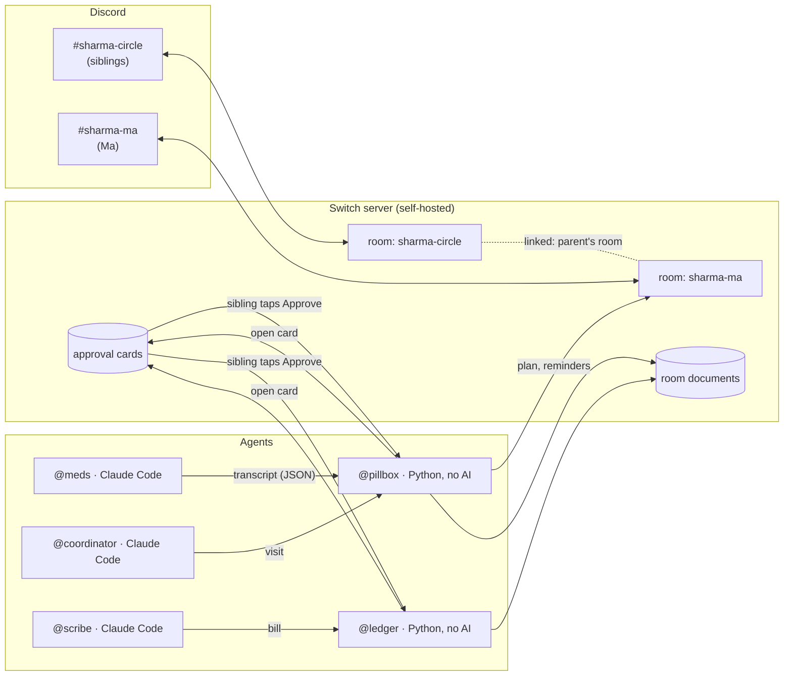

# CareCircle

**Three siblings, three cities, one parent. A shared family room where AI agents do the paperwork and a sibling taps *Approve* before anything changes.**

`Track 02 · Best Personal or Creative Workflow` · Built on [Switch](https://github.com/sandbox-quantum/switch) for the *Flip the Switch* hackathon

> 🎬 **Demo video (under 3 min):** _link coming_ · 📝 **Blog:** _link coming_

---

## The problem

Priya lives in Pune, Rahul in Bangalore, Ankit in Delhi. Their mother lives alone in Patna. Today their "system" is a WhatsApp group:

- the new prescription is a blurry photo three days up the chat;
- nobody is sure who is taking Ma to the cardiologist on Friday;
- Ankit paid ₹2,400 for lab tests and has quietly stopped asking to be paid back;
- after the visit, only the sibling who went knows what the doctor said.

This is not rare. In the US alone, 63 million people care for a family member, six in ten of them while holding a job ([AARP, 2025](https://www.aarp.org/press/releases/2025-07-24-new-report-reveals-crisis-point-for-americas-63-million-family-caregivers)). In India, adult children working in another city is the norm.

## What CareCircle does

One Discord server, two rooms, five agents. **AI reads and writes, code checks and keeps the records, people decide.**

| Agent | Kind | Job | The human gate |
|---|---|---|---|
| `@meds` | Claude Code | Reads a prescription photo and copies every line **verbatim** | — it only transcribes |
| `@pillbox` | **code only, no AI** | Checks each transcribed line against the text it came from, keeps Ma's medicine list, reminds Ma at dose times, escalates missed doses | Approval card before the list changes |
| `@coordinator` | Claude Code | Works out the visit, asks who will take Ma | Question card: siblings pick |
| `@scribe` | Claude Code | Turns visit notes into a plain-language care log | — read-only output |
| `@ledger` | **code only, no AI** | Shared expenses, exact splits to the paisa, settle-up | Approval card before anything is recorded |

**Rooms:** `#sharma-circle` (siblings + all agents) and `#sharma-ma`, a calm room for Ma that only shows today's medicines and the next visit. The two are linked, so `@pillbox` knows where Ma's room is.

### What it looks like

```text
[#sharma-circle] Ankit: @ledger add 2400 lab tests
[#sharma-circle] 🃏 @ledger: Record ₹2,400 for lab tests?
        │ Paid by Ankit. Split: Priya ₹800 · Rahul ₹800 · Ankit ₹800.
        [ Approve ]  [ Reject ]
   👆 Ankit taps [ Approve ]
[#sharma-circle] @ledger: ⚠️ Ankit can't decide this one: nobody approves their own expense —
        another sibling has to confirm it. I've put up a fresh card.
   👆 Rahul taps [ Approve ]
[#sharma-circle] @ledger: ✅ Recorded #1: ₹2,400 for lab tests — approved by Rahul.

[#sharma-ma] 🃏 @pillbox: 🌅 Ma, time for your morning medicines
        │ • Amlodipine 5 mg — 1 tablet (after food)
        │ • Metformin 500 mg — 1 tablet (with meals)
        [ ✅ Taken ]  [ ⏰ Not yet ]
   (nobody answers for 30 minutes)
[#sharma-circle] @pillbox: ⚠️ Nobody confirmed Ma's morning medicines.
[#sharma-circle] 🃏 @pillbox: Can someone call Ma?   [ 📞 I'll call ]
   👆 Rahul taps [ 📞 I'll call ]
```

Every card is a **native Switch approval card**; on Discord they are real buttons on your phone.

## Try it in 60 seconds (no Switch, no Discord, no API key)

```bash
git clone https://github.com/abhi-0404/carecircle && cd carecircle
uv sync
uv run carecircle demo     # plays the whole story with the real agent code
uv run pytest              # 137 tests
```

`carecircle demo` runs the real `@ledger` and `@pillbox` code against an in-memory stand-in for Switch, with scripted taps and a recorded `@meds` reading of the [sample prescription](demo/samples/prescription-cardiology.png).

## How it works



1. **A prescription.** A sibling posts the photo and asks `@meds`. `@meds` (Claude Code) copies every line verbatim and fills in fields (name, strength, dose…) using only words from that line, then hands `@pillbox` a JSON transcript.
2. **Code checks it.** [`meds.py`](src/carecircle/meds.py) accepts a field only if its words and numbers appear, side by side and in order, in the line it was read from. A model that writes `Atenolol` for a line that says `Amlodipine`, or `10 mg` for `5mg`, is caught. Dose codes (`1-0-1`, `BD`, `TDS`, `5 ml TDS`, `SOS`) become clock times from a fixed table, never from a model.
3. **A person approves.** `@pillbox` shows the checked list on an approval card. Only when a family member taps *Approve* does it update the `medicine-list` document and post the plan in Ma's room.
4. **Every day.** At each dose time `@pillbox` asks Ma "Taken?" in her room. If nobody answers, the family room is told and asked who will call. Switch has no scheduler, so this clock lives in `@pillbox`.
5. **Visits and money.** `@coordinator` asks the family who goes and hands the visit to `@pillbox`, which tells Ma and reminds her the evening before and two hours before. `@ledger` splits every bill to the paisa.

## Why Switch is central (remove it and this breaks)

| Switch feature | Used for | Where | Without it |
|---|---|---|---|
| **Native approval cards** (`/agent-sessions/…/approvals`) | Every change to money, medicines or the call rota | [`switch_client.py`](src/carecircle/switch_client.py) `open_approval` · `ledger_agent.py` · `pillbox_agent.py` | Approvals become typed text anyone can fake; no buttons on phones |
| **Who answered a card** (`answeredBy`) | Rules in code: only family counts, nobody approves their own expense, payments confirmed by the receiver | `ledger_agent.py` `approval_problem` | No accountable approver |
| **Agent protocol** (WebSocket + operations, no SDK) | `@ledger` and `@pillbox` are custom agents written against the raw protocol | `switch_client.py` `RoomStream` | Our code-only agents can't join the room |
| **Managed Claude Code agents** | `@meds`, `@scribe`, `@coordinator`: the AI the family already uses, placed in the room | [`carecircle.template.yaml`](templates/carecircle.template.yaml) | Each sibling copy-pastes into their own chatbot |
| **Agent-to-agent handoff** (mentions) | `@meds → @pillbox`, `@coordinator → @pillbox`, `@scribe → @ledger` | template instructions · `pillbox_agent.py` `_intake` | AI output reaches records unchecked |
| **Room documents** | `care-plan` (people-only), `medicine-list`, `expense-ledger` (each edited only by its agent), `care-log`, `appointments` | `sync_document` in both agents | No shared, owned source of truth |
| **Linked rooms** | Ma's room is linked as "parent's room"; `@pillbox` finds it via `list_linked_rooms` | template `links:` · `parent_room_of` | Ma sees the family's money talk, or nothing |
| **Templates** | One click creates 3 Claude Code agents, 2 linked rooms, docs and a kickoff | `templates/` (passes Switch's validator: 0 errors, 0 warnings) | Hand-wiring every room and agent |
| **Messaging bridges** | Discord today; Slack, Teams, Telegram, Mattermost unchanged | Switch | Locked to one chat app |
| **Addressing policies** | Only people and `@scribe` may address `@ledger`; only people, `@meds` and `@coordinator` may address `@pillbox`. The server refuses anyone else before the agent sees it | [`admin.py`](src/carecircle/admin.py) · `uv run carecircle lock` | A confused or hijacked AI agent could post "@ledger add 50000…" |
| **Owner-only agent settings** | Agents can't change their own permissions (Switch answers 403) | observed on `update_agent_detail` | An agent could open itself up |

Verified live: an agent outside the list wrote `@ledger add 50000 gold chain paid by abhishek`; Switch answered *"You're not permitted to direct messages to me in this room — my operator has restricted who can address me here."* and no card was ever opened.

## Safety

- **Not medical advice.** Agents copy what doctors wrote and say "ask the doctor or pharmacist" when unsure. Nothing changes a dose; unclear lines are left out and listed on the card.
- **Safety-relevant numbers never come from a model.** Doses become times from a fixed table; every rupee is computed in integer paise ([`ledger.py`](src/carecircle/ledger.py), property-tested over thousands of random splits).
- **People decide.** No record changes without a family member's tap; a stranger's tap re-issues the card.
- **Self-hosted, synthetic.** The Switch server runs on the family's own machine. The demo uses fictional, watermarked documents only.

## Run it for real

**You need:** [Switch Console](https://github.com/sandbox-quantum/switch/releases/latest) (0.40+), Docker running, Claude Code signed in, a Discord server, Python 3.11+ and [uv](https://docs.astral.sh/uv/).

1. **Switch.** Install Switch Console, choose *Set up a server on this computer*, and keep its server window open.
2. **Discord.** Create a bot ([guide](https://docs.switchagents.ai/switch-rooms/deploy/messaging-apps/index)) with the Server Members and Message Content intents and these permissions: View Channels, Send Messages, Send Messages in Threads, Create Public Threads, Manage Webhooks, Manage Channels, Manage Roles, Read Message History, Attach Files, Add Reactions. Connect it in Switch Console → Home → Messaging apps.
3. **This repo.**
   ```bash
   cp .env.example .env                 # add a registration key from the Switch Gateway
   cp circle.example.json circle.json   # your family's names and chat handles
   uv sync
   uv run carecircle register ledger
   uv run carecircle register pillbox
   uv run carecircle run                # keep running
   ```
4. **One click.** Run [`templates/carecircle.template.yaml`](templates/carecircle.template.yaml) from Switch Console → Templates. It creates `@meds`, `@scribe`, `@coordinator` and both rooms.
5. **Lock it down.** `uv run carecircle lock` sets the addressing policies (people plus the named agents only). It signs in to the gateway with `SWITCH_ADMIN_EMAIL` / `SWITCH_ADMIN_PASSWORD`, or with the admin login Switch Console generated on this computer.
6. Post the [sample prescription](demo/samples/prescription-cardiology.png) in `#<family>-circle` and ask `@meds` to read it.

No Claude Code? [`carecircle-rooms.template.yaml`](templates/carecircle-rooms.template.yaml) sets up the rooms with only the two code agents.

## Honest limits

- Built and tested on Windows 11 with Switch Console 0.40.1 / Switch 0.31.0 and Discord. Other bridges should work, but weren't tested.
- `@pillbox` must be running to send reminders; if it's down, the reminder is skipped (it never sends a stale one).
- The prescription is read once by `@meds`; a second, independent OCR read is supported by the checker (`ocr_text`) but not wired in, and the card says so.
- People are recognised by their chat names in `circle.json`; Switch's identity linking would be stronger.
- Amounts are in rupees; dose times are fixed (8 AM, 2 PM, 6 PM, 9 PM).

## Project layout

```text
src/carecircle/
  switch_client.py   agent protocol client: registration, operations, approval cards, WebSocket
  ledger.py          money: splits in paise, balances, fewest-transfers settle-up
  commands.py        @ledger's fixed grammar ("add 2400 lab tests paid by ankit")
  ledger_agent.py    @ledger
  meds.py            prescription checker and schedule
  pillbox_agent.py   @pillbox: list, approvals, reminders, escalation, visits
  service.py         `carecircle register | run | demo`
  demo.py            the offline story
templates/           one-click Switch templates
demo/                synthetic, watermarked sample prescription and bill
tests/               137 tests
```

## Built during the hackathon

Everything in this repository was written from 5 to 7 November 2026, during the hackathon window, with Claude Code as a pair programmer. The git history shows the steps.

---

*Not medical advice. CareCircle copies what doctors write and helps a family share the work; decisions stay with the family and their doctors.*
